# João Vitor Reimberg

## Full Stack Developer

I build practical software for real workflows: web applications, APIs, automation tools and cloud-ready systems.

I enjoy taking a problem from the first interface to the data model, integrations and delivery. My work combines product thinking with hands-on development, testing and continuous improvement.

## Core stack

| Area | Technologies |
| --- | --- |
| Frontend |  React, TypeScript, JavaScript, Next.js, HTML, CSS, Tailwind CSS |
| Backend |  Node.js, NestJS, .NET, ASP.NET, C#, VB.NET, PHP, Laravel, Python, REST APIs |
| Data |  PostgreSQL, MySQL, SQLite, Supabase, SQL, PL/SQL |
| Cloud & delivery |  AWS, Docker, environment-aware deployments |
| Quality |  Vitest, Jest, ESLint, validation and secure application architecture |
| Tools & automation |  Git, GitHub, WordPress, n8n, Model Context Protocol (MCP), Jira, cPanel |

## Featured projects

### [Digital Portal](https://github.com/JhonReimberg/fv-digital-portal-showcase)

A sanitized portfolio showcase of a social media operations portal developed for a company in Portugal. It brings internal teams and clients into separate workspaces for campaigns, content approvals, comments, assets and performance reporting.

**Next.js · React · TypeScript · Supabase · Postiz · Vitest**

### [Retenfix Academia](https://github.com/JhonReimberg/retenfix-academia)

A Windows training application for sales and inventory teams working with sealing components. It includes learning modules, product lookup, assessments, local history, CSV export and an interactive 3D lab.

**JavaScript · Three.js · SQLite · Testing · Secure local-first architecture**

### [Adv. Inteligente Updates](https://github.com/JhonReimberg/adv-inteligente-updates)

A public release channel containing installers and version metadata for a desktop application.

## What I care about

- Designing interfaces that make complex workflows easier to understand
- Building maintainable full stack systems with clear boundaries
- Treating data privacy and secure defaults as part of the product
- Testing important business rules instead of relying only on the happy path
- Shipping incrementally and improving from real feedback

## Currently exploring

Cloud deployment patterns, reliable integrations, automation workflows and better developer experiences for small teams.

More projects and experiments are available in my public repositories.
